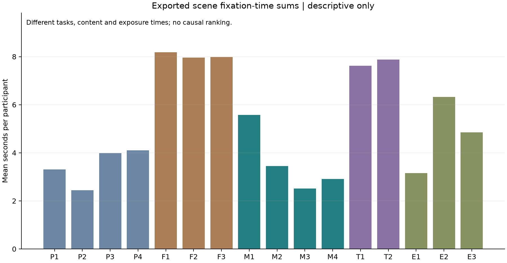

# 复算结果与原报告对照

[返回总览](./README.md) · [完整方法](./METHODS.md)

## 1 场景与样本

16个图像场景均匹配到GazeTrack导出，每个场景13个被试标识，共208条被试与场景汇总。四个会员场景有相同13人的完整配对。

任务包括：四个不同目标的查找、三个10秒信息流浏览、四个会员区域查找、两个任务类型环节，以及三个购买入口或教程入口查找。不能把它们全称为会员复杂度实验，也不能把场景名“位置”理解为仅操纵了位置。

## 2 四个会员场景的统计探索

| 指标 | Friedman Q | 被试内置换 p | Holm 校正 p | Kendall W |
| --- | ---: | ---: | ---: | ---: |
| 目标区域注视时长 | 7.9767 | 0.04356 | 0.08712 | 0.2045 |
| 目标区域注视条目数 | 6.0242 | 0.10854 | 0.10854 | 0.1545 |
| 目标时长占全场景注视时长比例 | 8.7600 | 0.02864 | 0.08592 | 0.2246 |

每项使用99,999次被试内置换，种子固定。表中的置换 p 为Monte Carlo估计；每个Q均与SciPy独立计算核对。没有采用少量重复条件时的渐近卡方p作为主要结果。

不校正时，两个指标低于0.05；将三项相关比较一起校正后，均不低于0.05。本次不再追做并挑选两两显著差异，member_posthoc.csv因此为空。

这不能证明所有界面一样有效。样本较小，且产品、材料、区域面积、展示时长与熟悉度均可能产生影响。当前结果只支持对现有场景作有限探索。

## 3 目标区域与全场景指标必须区分

| 场景 | 全场景注视时长均值 秒 | 目标 AOI 注视时长均值 秒 | 目标 AOI 面积占画面 |
| --- | ---: | ---: | ---: |
| 会员1 | 5.575 | 3.115 | 8.21% |
| 会员2 | 3.450 | 1.685 | 6.50% |
| 会员3 | 2.512 | 2.117 | 9.29% |
| 会员4 | 2.908 | 1.775 | 7.53% |

目标区域面积不同，不能把其时长占比变化全部归因于视觉设计。会员3的目标时长占比更高，但也有更大的目标区域；本次没有用模型消除这些混杂。

首次目标注视时间只在检测到目标注视的记录中统计，未检测到的人不设为0。由于有两个场景各有一人没有目标注视，不能只比较条件性的首次注视均值而忽略覆盖率。

## 4 与历史报告的对应情况

历史报告对会员2、3、4列出的总注视时长均值分别为5.23、3.18、4.85秒。本次对导出的全场景注视条目按不小于0.05秒汇总，得到3.450、2.512、2.908秒；相应目标区域均值为1.685、2.117、1.775秒。

目前尚不能从现存材料直接复现历史表格的口径。这不等于原始数据是假的；可能涉及不同导出、过滤、区域、版本或分析错误，需要原计算过程才能确定。

原报告把更长注视解释为更深入加工。当前不沿用这一直接推断：较长注视还可能与内容长度、搜索困难、区域大小或停留时长有关。现有任务只要求找到后按空格，缺少确认理解或识别正确的独立记录。

## 5 全16场景的描述

代码映射：P1–P4为位置组，F1–F3为信息流组，M1–M4为会员组，T1–T2为任务类型组，E1–E3为其他入口组。

信息流和自由浏览场景固定展示约10秒，手动搜索场景由按键结束，时长机制不同。图中柱高不应解释为效率或体验质量排名。全量均值、中位数、离散程度及有效数量见data/scene_summary.csv。

## 6 附带问答记录

读取工程Subjects的info字段后得到：

- 第一组广告数量：10条记录为1，1条为2，2条为3。
- 第二组广告数量：1条为2，2条为3，10条为4。
- 第三组广告数量：13条均为1。
- 应用类型：12条为购物，1条为餐饮。

这些是保存字段的频数汇总，不是已经核对正确答案的识别率。Recording区域包含不同的默认值，因此没有与info字段混用或重复计数。字段解释仍建议由原软件导出作最终确认。

现存材料尚不能核实主观侵入感评分来源，因此未纳入本次复算。广告数量判断不等于主观侵入感评分；后续如恢复评分题、逐份答卷及编码规则，可再核对历史表格。本次不重算侵入感及其回归。

## 7 可以用于公开介绍的表述

> 基于课程实验保留的工程与眼动导出，重新整理16个场景、13名被试的记录，恢复任务与目标区域，核对逐人跨场景结构，并完成匿名汇总与配对探索。复算发现，原报告的部分分析口径不能直接复现；多指标校正后，会员四场景的差异证据不足。项目重点展示数据整理、分析复核和研究反思。

该介绍对应本次重新整理的工作，不作为当年已经完成这些复算步骤的证明。
