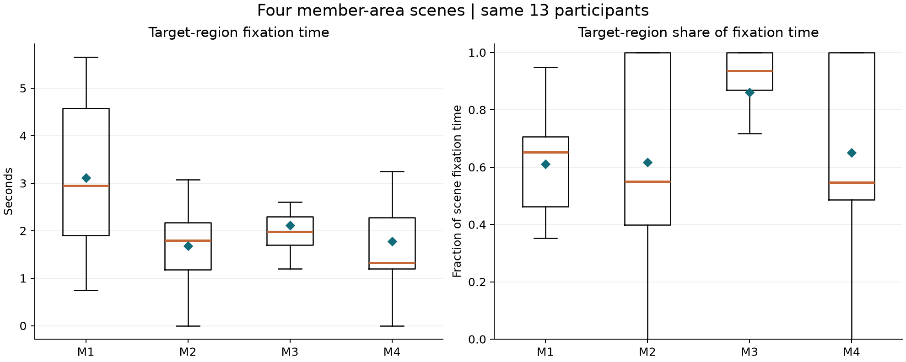

# 眼动实验数据复算与研究复盘报告

基于历史课程实验的任务恢复 数据复核与结果重述

作者 四件    实验所属报告年份 2025    复算与成文日期 2026年10月17日

## 研究概述

本报告重新整理课程实验保留的眼动工程与导出文件，恢复任务、目标区域和逐人跨场景关系，并复核历史报告中的部分结论。共识别16个图像场景、13个被试标识，形成208条被试与场景汇总。实验覆盖目标查找、信息流浏览、会员区域查找及购买或教程入口查找，不应统一概括为单一的会员复杂度实验。

复算确认四个会员场景来自同一组13人的重复测量。对目标区域注视时长、注视条目数和时长占比进行被试内探索比较后，三项检验经Holm校正均未达到0.05。现有数据不足以支持某种会员界面复杂度导致更好体验的结论，也不能据此证明四种界面效果相同。

历史报告的部分均值尚不能按现存导出口径复现；主观侵入感评分的来源也未恢复。这些问题应保留为待核对事项，不能直接推断原始实验虚假，也不能用推测补齐评分。

### 工作归属与时间边界

2025年的实验由团队共同开展，我参与实验测试，并负责部分测试材料的撰写。根据本人回忆，该部分可能属于靠后的环节，具体场景尚不能可靠对应。我基于团队共享的初始资料独立完成个人报告及其中的数据分析，并使用AI辅助分析和表达。现有材料不足以把全部实验设计、设备操作或数据采集归为个人独立完成。

2026年的工作为历史资料整理与复算：恢复16场景任务目录，校验目标区域，修正重复测量的分析口径，生成匿名汇总，并重新讨论证据限制。该工作不追溯为2025年已经完成的研究步骤。适老化游戏问卷与设计方案属于另一部分，本报告不重新计算其结果。

## 一 实验任务恢复

以工程中的指导语和场景内部名称恢复任务。代码仅用于本报告阅读，不改变原工程场景名。手动场景以按空格结束；自动浏览场景设定约10秒。

| 代码 | 工程场景 | 任务及结束方式 |
| --- | --- | --- |
| P1 | 位置 | 查找帖子点赞数量  按空格 |
| P2 | 位置2 | 查找会员中心  按空格 |
| P3 | 位置3 | 查找缴付账单  按空格 |
| P4 | 位置4 | 查找热点  按空格 |
| F1 | 信息流 | 浏览10秒  随后回答广告数量 |
| F2 | 信息流1 | 浏览10秒  随后回答广告数量 |
| F3 | 信息流2 | 浏览10秒  随后回答广告数量 |
| M1 | 会员1 | 查找会员区域  按空格 |
| M2 | 会员2 | 查找会员区域  按空格 |
| M3 | 会员3 | 查找会员区域  按空格 |
| M4 | 会员4 | 查找会员区域  按空格 |
| T1 | 任务类型 | 查找双十一入口  按空格 |
| T2 | 任务类型-Copy | 自由浏览10秒  随后判断应用类型 |
| E1 | 1 (2) | 查找洗浴用品购买入口  按空格 |
| E2 | 2 (2) | 查找新手教程  按空格 |
| E3 | 3 (2) | 查找面膜购买入口  按空格 |

### 这些任务能够观察什么

目标查找任务主要记录指定目标的视觉搜索与注意分配；信息流浏览后的问答记录广告数量判断；应用类型问答记录对界面类别的判断。它们并未直接测量完整操作流程、购买转化或长期使用体验。

“找到后按空格”是参与者自行报告找到目标。注视进入目标区域、按下空格与正确识别目标，三者不能互相替代。现存记录缺少目标点击与正确性核验，因此不计算任务成功率，也不把场景时长直接命名为正确完成时间。

## 二 数据处理与指标定义

### 输入与样本结构

分析读取保留工程中的场景、指导语、兴趣区多边形、场景开始结束时间和Subjects的info问答字段，并对应GazeTrack与GazeAOI导出。使用广告3工程；广告1工程不重复计入，汽车外形工程不纳入。本次使用软件已经生成的注视条目，未重新解析二进制眼动信号，也未重新运行注视检测。

16个场景各有13个相同的被试标识。统计单位为被试，不把注视条目数当作样本量，也不把四个会员场景中的13人累计为52名独立参与者。年龄、视力、校准质量等背景不能由当前汇总推断，因此不能将该样本称为老年用户样本。

### 筛选与区域校验

主分析保留持续时间不小于0.05秒的注视条目，与历史报告描述的阈值对齐；这只是处理选择，不是普适有效性标准。另保留0秒与0.10秒阈值的描述性敏感性汇总，不通过调整阈值挑选显著结果。主阈值下有14条过短记录被排除。

从工程恢复AOI多边形，以注视点是否位于区域内匹配，边界计入区域；场景的多个目标区域取并集。重新计算的各命名AOI被注视人数比例均与可对应的软件导出一致。这支持本次区域恢复和坐标处理的一致性，但不等于所有软件统计均已复现。

| 指标 | 定义与解释 |
| --- | --- |
| 全场景注视时长 | 保留条目时长之和  不等于目标查找时间 |
| 目标AOI时长与条目数 | 落入目标区域的时长及条目数  无命中者计0 |
| 目标时长占比 | 先计算每人的目标时长除以全场景时长  再汇总 |
| 首次目标注视时间 | 仅对检测到目标注视者统计  无命中者保留缺失 |
| 场景展示时长 | 工程结束时间减开始时间  含反应与切换开销 |

### 时间与缺失处理

工程时间按每秒一千万时间单位换算。52条配置为10秒的自动展示记录换算为约10.02至10.11秒，与设置相符。未配置AOI的自由浏览场景不填区域指标；未命中目标者的首次注视时间不能填0，否则会错误表示目标被立即发现。

## 三 会员区域查找的复算结果

四个会员场景均有13人的完整配对。下表区分全场景注视和目标区域注视；均值不是逐条注视事件的平均。

| 场景 | 全场景时长 秒 | 目标时长 秒 | 目标时长占比 | 目标命中人数 |
| --- | --- | --- | --- | --- |
| 会员1 | 5.575 | 3.115 | 61.1% | 13/13 |
| 会员2 | 3.450 | 1.685 | 61.7% | 12/13 |
| 会员3 | 2.512 | 2.117 | 86.1% | 13/13 |
| 会员4 | 2.908 | 1.775 | 65.0% | 12/13 |

| 指标 | Friedman Q | 置换 p | Holm p | Kendall W |
| --- | --- | --- | --- | --- |
| 目标注视时长 | 7.9767 | 0.04356 | 0.08712 | 0.2045 |
| 目标注视条目数 | 6.0242 | 0.10854 | 0.10854 | 0.1545 |
| 目标时长占比 | 8.7600 | 0.02864 | 0.08592 | 0.2246 |

使用含并列秩修正的Friedman Q，以99,999次被试内标签置换估计p值；三个指标统一进行Holm校正。检验为未预注册的探索，且依赖被试内可交换等假设。场景顺序若固定，顺序与材料效应无法分离。Q值另与SciPy核对；未以四条件下的渐近卡方p值作为主要结果。

图1 会员场景的目标区域指标分布  每个场景13人

两个未校正p值低于0.05，但三项校正后均未达到阈值，因此不继续挑选两两显著比较。M3目标时长占比的均值较高，不能直接等同于更好理解或更好体验。四个AOI面积占画面约8.21%、6.50%、9.29%、7.53%，同时存在材料、内容、熟悉度和展示时长差异。

## 四 全部场景与附带问答

图2 全16场景的全场景注视时长均值  仅作描述

P为位置组，F为信息流组，M为会员组，T为任务类型组，E为其他入口组。自动浏览场景固定约10秒，手动查找场景由参与者按键结束，因此不能用柱高对应用效率或界面质量排序。全量均值、标准差、中位数与四分位数保存在配套汇总表。

### 工程中保留的问答分布

| 记录项 | 保存答案及人数 |
| --- | --- |
| 第一组广告数量 | 1个 10人    2个 1人    3个 2人 |
| 第二组广告数量 | 2个 1人    3个 2人    4个 10人 |
| 第三组广告数量 | 1个 13人 |
| 应用类型 | 购物 12人    餐饮 1人 |

上述频数来自Subjects的info字段。Recording字段含有不同的默认值，未将两者混用或重复计数。由于字段映射尚未通过原软件重新导出作最终确认，且正确答案未独立核对，结果仅作为保存答案的频数，不解释为广告识别正确率。

### 主观侵入感暂不重算

现存材料尚不能核实主观侵入感评分来源，因此未纳入本次复算。后续如恢复明确的评分题、逐份答卷及编码规则，可再核对其与历史表格的对应关系。

广告数量判断属于识别任务，主观侵入感属于体验评价，不能将前者替换为后者。本次不生成缺失评分，不重算原侵入感回归，也不把眼动记录真实作为主观评分来源可靠的证明。

## 五 历史结论的修正与研究限制

### 历史均值尚不能直接复现

| 场景 | 历史全场景均值 秒 | 本次全场景均值 秒 | 本次目标区域均值 秒 |
| --- | --- | --- | --- |
| 会员2 | 5.23 | 3.450 | 1.685 |
| 会员3 | 3.18 | 2.512 | 2.117 |
| 会员4 | 4.85 | 2.908 | 1.775 |

差异可能来自导出版本、筛选条件、区域定义或分析错误。原计算文件已经遗失，现阶段无法确认具体原因。保留历史报告并新增日期明确的复算版本，比直接覆盖原表更有利于追踪口径变化。

### 分析单位需要修正

历史报告将部分场景按组间比较描述；现存记录显示四个会员场景是同一13人的重复测量。本次据此改用被试内探索方法。重复测量方法能处理同一个人的关联，却不能消除跨产品材料、区域面积或任务顺序造成的混杂。

### 不能把注视越久解释为体验越好

较长注视可能来自注意吸引、阅读内容较多、搜索困难或停留时间较长；仅凭时长不能判断理解深度。同样，较短注视可能意味着迅速找到目标，也可能意味着没有注意到。解释应同时依赖正确性、任务完成、首次目标注视、主观反馈等证据，而当前记录只覆盖其中一部分。

### 任务与材料的控制不足

部分材料来自不同产品和页面，目标语义、视觉密度、面积与用户熟悉度可能同时变化。“位置”“会员”等工程名称不能自动视为受到控制的单一实验因素。当前材料适合作为课程探索和研究流程练习，不足以形成普遍的布局因果结论。

### 样本与记录的适用范围有限

样本仅13人，参与者背景与校准质量未在本次复算中重新核验，且没有独立的目标点击正确性。统计未达阈值不是界面等效的证明。报告不能推出老年群体的偏好，也不能据此验证适老化游戏玩法。缺失的原分析文件和主观量表限制了历史结论的可追溯性。

## 六 后续研究建议与资料管理

### 如果重新设计实验

先把问题限定到一个具体判断，例如“在内容和位置一致时，会员入口的显著性变化是否影响目标查找”。采用同一界面模板，仅改变目标因素；统一目标语义、内容量、区域面积及展示方式。若必须比较不同产品，应将其定义为产品案例比较，不将差异归因于某个单独因素。

为每个任务保存正确目标、点击位置或答案及完成状态，将正确率和正确完成时间与眼动指标配合使用。记录任务顺序并进行随机化或平衡，保存设备参数、校准与有效数据标准。先做小规模预试，再根据主要指标和预期精度确定样本方案；不直接把13人作为充分性依据。

如研究适老化，应明确招募对象并记录相关使用经验；将广告识别、任务查找和主观侵入感分开设计。主观评价保留题目、量尺、逐份答卷、编码规则和缺失处理，不事后根据眼动结果补造态度评分。

### 本次整理记录

| 环节 | 本次完成内容 |
| --- | --- |
| 资料定位 | 恢复16场景与指导语  识别重复导出及无关工程 |
| 数据核对 | 逐人对齐208条汇总  核对AOI命中比例和展示时间 |
| 复算与解释 | 统一筛选及指标定义  进行配对探索与多重校正 |
| 报告修订 | 分离历史与复算结论  标出无法复现及待核实部分 |
| 公开准备 | 仅保留汇总图表和方法  原始身份及逐人资料留在本地 |

### 隐私与可复核范围

公开材料使用作者名“四件”，不包含同学姓名、身份对照表、逐人轨迹、逐人问答或原始刺激截图。被试标识在本地去标识处理后用于配对；身份映射不另行保存。小样本汇总不等于形式化的不可重识别证明。原始输入不公开，读者可以审查代码与汇总，但无原始材料时不能独立复现全部计算。

### 结论

本次复算的主要成果是恢复实验结构、校正分析口径并明确解释边界。现有结果支持对目标查找和注意分配的有限描述，不支持以注视时长单独判定界面优劣。后续应优先补齐正确性、主观量表来源和实验控制，再开展面向具体设计问题的验证。

### 方法参考与配套资料

统计方法参考：SciPy friedmanchisquare、SciPy wilcoxon及statsmodels multipletests官方文档。具体地址与复算命令见配套METHODS.md。场景目录、汇总结果、检验结果与匿名规则分别见TASKS.md、data/scene_summary.csv、data/member_tests.csv和PRIVACY.md。

[Friedman检验说明](https://docs.scipy.org/doc/scipy/reference/generated/scipy.stats.friedmanchisquare.html)

[配对秩检验说明](https://docs.scipy.org/doc/scipy/reference/generated/scipy.stats.wilcoxon.html)

[多重检验校正说明](https://www.statsmodels.org/stable/generated/statsmodels.stats.multitest.multipletests.html)
